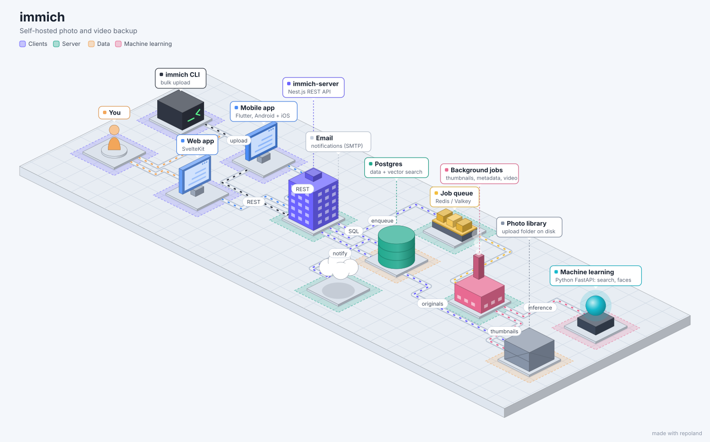
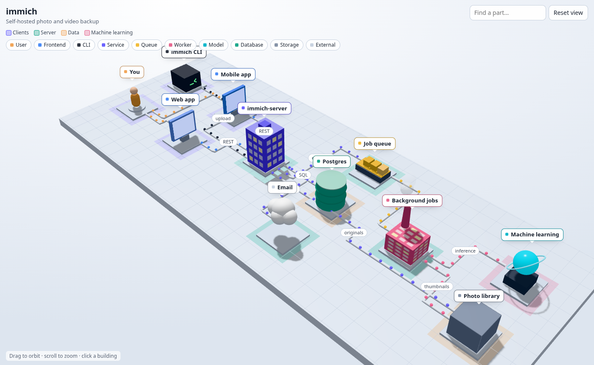
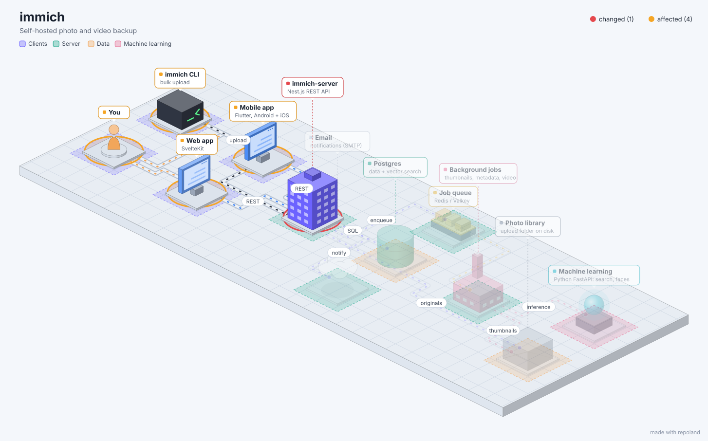
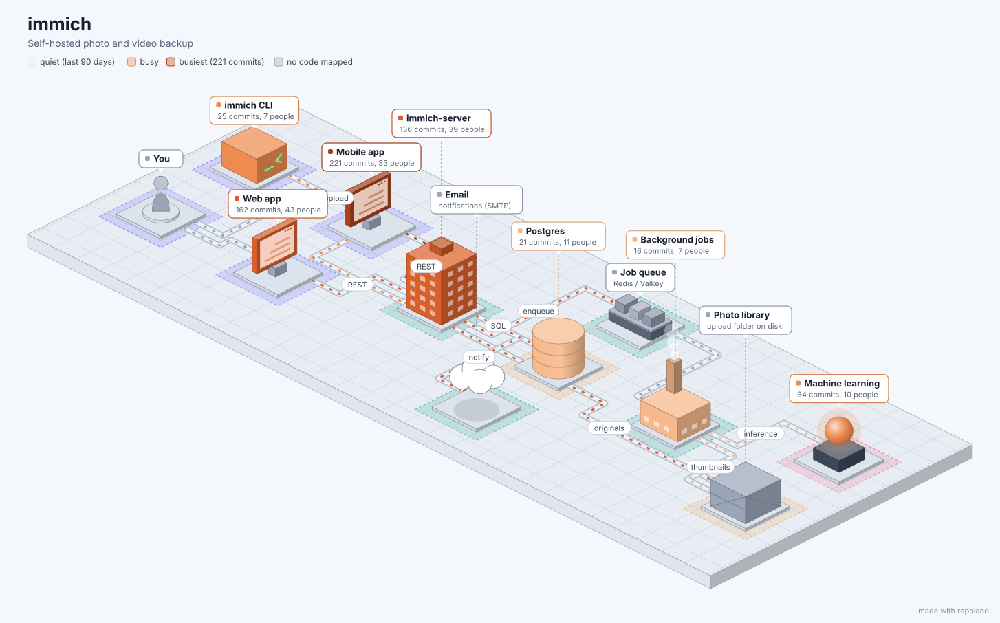
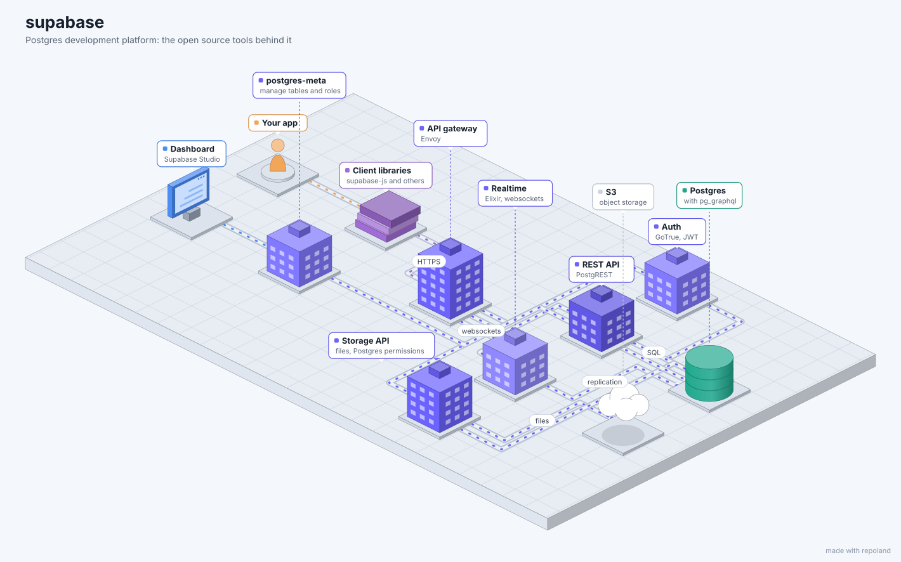
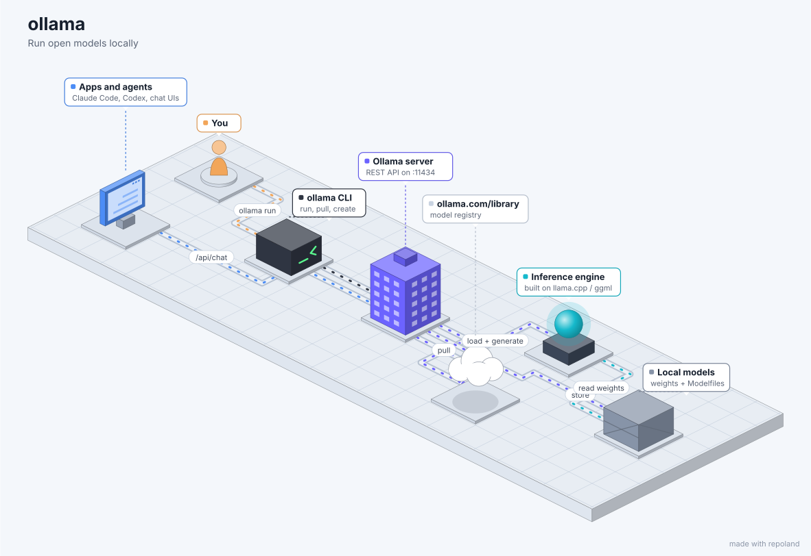
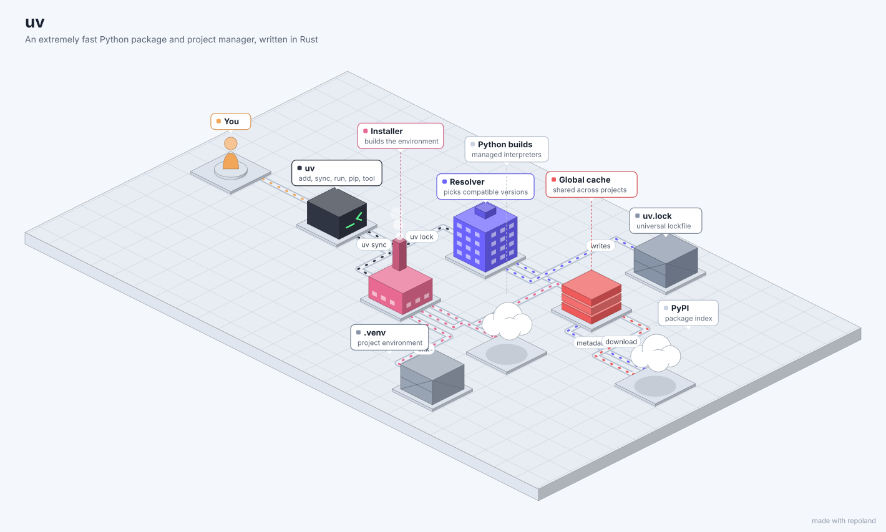
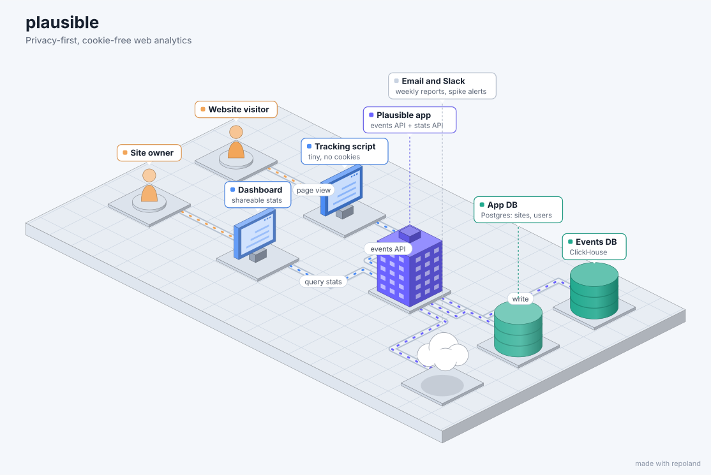

# repoland

**Map any codebase as an isometric town you can explore in 3D, and keep the map true: CI fails when it drifts,
and every pull request shows which parts it touches.**

[](https://github.com/yassine-rebhi-dev/repoland/actions/workflows/ci.yml)
[](https://www.npmjs.com/package/repoland)



<sub>[immich](https://github.com/immich-app/immich), mapped from its own docs and repo tree. Animated pipes, districts, owned code paths. **[Open it in 3D](https://yassine-rebhi-dev.github.io/repoland/)**.</sub>

```sh
npx repoland scan      # draft a map from your compose files, workspaces and dependencies (no AI, no network)
npx repoland           # repoland.svg for your README
npx repoland --html    # repoland.html: explore it in 3D
```

With Claude Code, run `npx repoland skill` and ask **"map this repo with repoland"**: the agent starts from the scan,
reads the code, and writes a map with descriptions and the files each part owns.

## Why

Architecture diagrams are missing, out of date, or a wall of boxes nobody reads. repoland fixes all three:

- **People look at it.** Services are buildings, databases are tanks, queues are conveyors carrying crates, external
  APIs are clouds, models are glowing orbs. Busy hubs stand taller. Data flows through animated pipes.
- **It stays true.** Each part lists the code it owns. `repoland check` fails CI when a part's code is gone or a new
  service appears that nobody drew.
- **It answers a daily question: "what does this PR touch?"** Changed files light up their buildings in red and
  everything that depends on them in amber, as an image and a PR comment.

## Explore in 3D



`repoland --html` writes **one self-contained file** (works offline, no install for whoever opens it):

- orbit, zoom and pan; it slowly turns until you touch it
- click a building: the camera flies to it, its callers and callees stay lit, and a panel shows its description,
  the code paths it owns and its connections (each clickable)
- search parts, hide kinds, see districts
- respects `prefers-reduced-motion`

## Keep it true in CI

```sh
npx repoland check
```
```
repoland.json is valid: 11 parts, 12 flows.
  stale:     "Billing" owns services/billing/**, which matches no file any more
  not shown: frontend "admin" (apps/admin/**) exists in the repo but not on the map
Map drift: 1 stale, 1 missing. Update repoland.json (your agent can, with the repoland skill).
```

Parts you leave off on purpose go in `"ignore"`. Exit code 1 on drift.

## See what a pull request touches

```sh
npx repoland impact --md               # against origin/main; or --base <ref>, or --files a,b
```



> ### repoland: what this change touches
> **Changed:** immich-server
> **Affected (depends on a changed part):** Mobile app, Web app, immich CLI, You

A ready-to-use GitHub workflow (drift check + PR comment + SVG artifact) is in
[`examples/repoland-ci.yml`](examples/repoland-ci.yml). `impact --html` gives the same view in 3D.

## Where's the churn? Who owns what?

```sh
npx repoland --color activity          # commits and people per part, last 90 days (--days N)
npx repoland --color team              # owners from CODEOWNERS; parts nobody owns stand out in grey
```



<sub>immich, last 90 days of its git history. The 3D page (`--html`) has a switch for kind, activity and team.</sub>

## Ask the map from your agent (MCP)

```sh
claude mcp add repoland -- npx -y repoland mcp
```

Your agent gets five tools: **overview** of the architecture, **which part owns a file** (with what it calls and
what calls it), **what depends on a part**, **what a set of changed files touches**, and **drift check**. It reads
`repoland.json` from the project, so answers match the map your team reviews.

## More outputs

```sh
npx repoland --theme both              # repoland.svg + repoland-dark.svg, prints a <picture> snippet for GitHub dark mode
npx repoland export --mermaid          # Mermaid flowchart (GitHub, GitLab, Notion render it natively)
npx repoland --watch                   # re-render whenever repoland.json changes
```

## Draft a map without AI

`repoland scan` reads what the repo already declares:

| Source | Becomes |
|---|---|
| `docker-compose.yml` services | buildings typed by image (`postgres` → database, `redis` → cache, `kafka` → queue…); `depends_on` → pipes; build context → owned paths |
| npm / pnpm workspaces | one part per package (frontend, service, CLI, worker, library); workspace dependencies → pipes |
| Cargo workspaces, Go `cmd/*` | crates and binaries, path and `workspace = true` dependencies |
| dependencies (JS, Python, Go) | `pg` → Postgres, `bullmq` → job queue, `stripe` → Stripe, `@aws-sdk/client-s3` → S3, `openai` → OpenAI API, … |

Tests, docs, configs and storybooks are left out, and the result is capped at the 16 most connected parts
(`--max` to change). Tested on immich, n8n, documenso and uv; their quirks are regression tests.

## The scene

```json
{
  "title": "acme-shop",
  "groups": [{ "id": "core", "label": "Backend" }],
  "ignore": ["packages/eslint-config/**"],
  "nodes": [
    { "id": "web", "label": "Storefront", "kind": "frontend", "note": "Next.js", "paths": ["apps/web/**"] },
    { "id": "api", "label": "API", "kind": "service", "note": "Fastify", "group": "core",
      "paths": ["apps/api/**"], "description": "Orders, carts and checkout." },
    { "id": "db", "label": "Orders DB", "kind": "database", "note": "Postgres", "group": "core" }
  ],
  "edges": [
    { "from": "web", "to": "api", "label": "REST" },
    { "from": "api", "to": "db", "label": "SQL" }
  ]
}
```

Kinds: `user` `frontend` `service` `worker` `database` `cache` `queue` `storage` `external` `cli` `library` `model`.
Mistakes come back as a list with JSON paths (`nodes[2].kind: must be one of …`), so an agent can fix them in one pass.

## Gallery

Each scene was written from the project's own docs (see `source` in [`gallery/`](gallery)).

| | |
|---|---|
|  |  |
| [supabase](https://github.com/supabase/supabase) | [ollama](https://github.com/ollama/ollama) |
|  |  |
| [uv](https://github.com/astral-sh/uv) | [plausible](https://github.com/plausible/analytics) |

## All commands

```sh
npx repoland [scene.json]            # SVG (default scene: repoland.json)   --html, --color, --theme, --watch, --static, --no-credit, -o
npx repoland scan [dir]              # draft repoland.json                   --max <n>, --force, -o
npx repoland check [scene.json]      # validate + drift (exit 1)             --repo <dir>
npx repoland impact [scene.json]     # PR impact                             --base <ref>, --files a,b, --md, --html, -o
npx repoland skill                   # install the agent skill               --global, --print (for Codex, Cursor, …)
npx repoland example                 # starter scene
npx repoland export --mermaid        # Mermaid flowchart                     -o
npx repoland mcp                     # MCP server for agents (stdio)
```

### As a library

```ts
import { parseScene, renderSvg } from "repoland";
const svg = renderSvg(parseScene(json), { highlight: { changed: ["api"], affected: ["web"] } });
```

## Limits

- The map is only as true as the scene. `scan` only reports what config declares; the skill tells agents to
  include only what they saw. Review maps like any other change.
- Up to 30 parts. Bigger systems read better as one map per subsystem.
- Layout is automatic: you choose parts and flows, not positions.

## Contributing

See [CONTRIBUTING.md](CONTRIBUTING.md). Most wanted: more scanners (Kubernetes, Terraform, Django apps), new
building kinds, and real repos where `scan` gets it wrong.

## License

MIT
